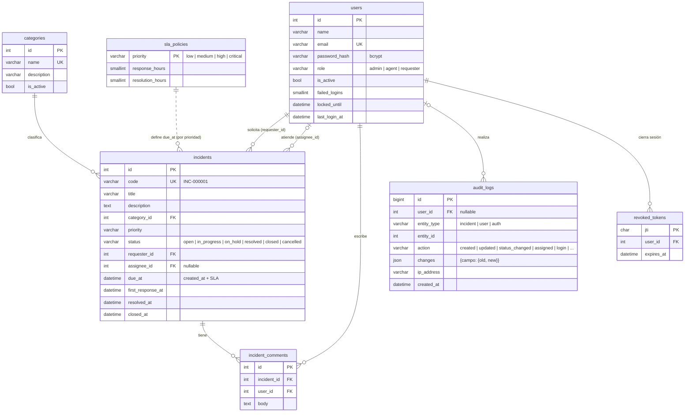

# Modelo de datos

Esquema completo en [`database/schema.sql`](../database/schema.sql) (MySQL 8 / MariaDB 10.6+, utf8mb4, fechas en UTC).



## Decisiones

- **Rol como columna con CHECK** (no tabla de roles): son 3 roles fijos definidos por el reto; un enum en PHP (`Kodex\Domain\Role`) y un `CHECK` en BD garantizan que no aparezcan valores inválidos.
- **Estados y transiciones en el dominio** (`Kodex\Domain\IncidentStatus`): la máquina de estados vive en un solo lugar del backend y se expone al front vía `GET /api/catalogs`, así el front no duplica reglas.

  ```
  open ──► in_progress ──► resolved ──► closed
   │          │   ▲            │
   │          ▼   │            └──► in_progress (reapertura)
   │        on_hold
   └──────────┴────────► cancelled
  ```
- **SLA por prioridad** (`sla_policies`): permite calcular `due_at` al crear y, con eso, las **vencidas** del dashboard. Los tiempos de atención salen de `first_response_at` y `resolved_at`.
- **Auditoría genérica** (`audit_logs`): una sola tabla para incidencias, usuarios y eventos de login; `changes` guarda el valor anterior y el nuevo de cada campo. Solo se inserta, nunca se edita.
- **Logout real**: el JWT lleva un `jti`; al cerrar sesión se guarda en `revoked_tokens` y deja de aceptarse aunque no haya expirado.
- **Bloqueo por fuerza bruta**: `failed_logins` y `locked_until` en `users`.
- **Índices** en las columnas por las que se filtra y ordena (estado, prioridad, categoría, responsable, solicitante, fechas) para que la búsqueda paginada del día 3 sea eficiente.
