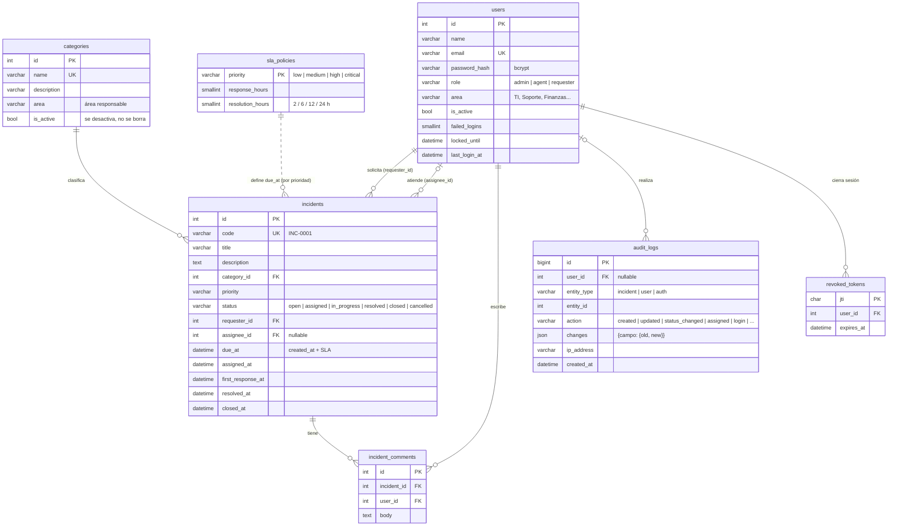

# Modelo de datos

Esquema completo en [`database/schema.sql`](../database/schema.sql) (MySQL 8 / MariaDB 10.6+, utf8mb4, fechas en UTC).



## Decisiones

- **Rol como columna con CHECK** (no tabla de roles): son 3 roles fijos definidos por el reto; un enum en PHP (`Kodex\Domain\Role`) y un `CHECK` en BD garantizan que no aparezcan valores inválidos.
- **Estados y transiciones en el dominio** (`Kodex\Domain\IncidentStatus`): la máquina de estados vive en un solo lugar del backend y se expone al front vía `GET /api/catalogs`, así el front no duplica reglas.

  ```
  open ──► assigned ──► in_progress ──► resolved ──► closed
   │                        ▲              │
   │                        └── reabrir ───┘
   └──► cancelled   (solo el solicitante, mientras está Abierta)
  ```

  Es el mismo "Flujo de estados" del Figma. Asignar responsable a una incidencia abierta la pasa a `assigned`.
- **SLA por prioridad** (`sla_policies`): Crítica 2 h · Alta 6 h · Media 12 h · Baja 24 h, editables por el admin. Al crear se calcula `due_at`; si una incidencia activa pasa de `due_at` queda **vencida** y aparece en el dashboard. El tiempo de atención es `resolved_at - created_at`.
- **Áreas** (`users.area`, `categories.area`): texto libre por ahora (TI, Soporte, Seguridad TI…). Permiten el filtro "Área" de Usuarios y mostrar el área responsable de cada categoría; si crece, se normaliza en una tabla `areas`.
- **Categorías no se borran**: con incidencias activas solo se desactivan (`is_active = 0`); la FK desde `incidents` impide borrarlas.
- **Auditoría genérica** (`audit_logs`): una sola tabla para incidencias, usuarios y eventos de login; `changes` guarda el valor anterior y el nuevo de cada campo. Solo se inserta, nunca se edita.
- **Logout real**: el JWT lleva un `jti`; al cerrar sesión se guarda en `revoked_tokens` y deja de aceptarse aunque no haya expirado.
- **Bloqueo por fuerza bruta**: `failed_logins` y `locked_until` en `users`.
- **Índices** en las columnas por las que se filtra y ordena (estado, prioridad, categoría, responsable, solicitante, fechas) para que la búsqueda paginada del día 3 sea eficiente.
